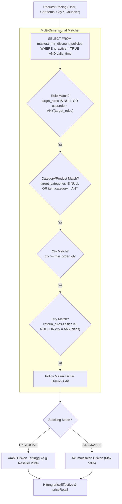

# Design Specification: Decoupled Multi-Dimensional Discount Policies Engine

**Date:** 2026-11-09  
**Status:** PROPOSED (Pending User Approval)  
**Author:** Antigravity Architect Team & Lead User  

---

## 1. Intent & Problem Statement

### 1.1 Background
Pada implementasi awal RBAC, nilai diskon persentase disimpan langsung sebagai kolom pada tabel `master.t_mtr_roles` (`discount_percent`).

### 1.2 Masalah (The Why)
1. **Pelanggaran Single Responsibility Principle (SRP)**:
   * Tabel `roles` adalah domain **Identity & Access Management (IAM)** untuk mendefinisikan otoritas dan izin akses (`can_access_admin`, `can_access_b2b`).
   * Diskon adalah domain **Pricing & Commercial Strategy**.
2. **Keterbatasan Skalabilitas**:
   * Menempelkan diskon pada role membuat sistem tidak fleksibel jika di masa depan ada diskon non-role:
     - Diskon partai besar (volume tier: $\ge 3$ pcs).
     - Diskon berbasis kategori/SKU knalpot.
     - Diskon promosi musiman / kode kupon voucher.
     - Diskon regional tingkat Kota/Kabupaten (misal subsidi ongkir untuk distributor/bengkel luar Jawa).
3. **Ambigu dalam Logika Bisnis**:
   * Jika seorang Reseller membeli saat ada Promo Diskon Publik atau Promo Kategori, sistem tidak memiliki aturan baku apakah diskon ditumpuk (*stackable*) atau diambil yang terbesar (*exclusive*).

---

## 2. Goals, Non-Goals, and Anti-Goals

### 2.1 Goals
* **Pemisahan Penuh**: Hapus kolom `discount_percent` dari `master.t_mtr_roles`.
* **Tabel Terpusat**: Buat tabel `master.t_mtr_discount_policies` dengan dukungan multi-targeting:
  * `target_roles TEXT[]`: Satu policy bisa berlaku untuk beberapa role sekaligus (misal `['reseller', 'distributor']`).
  * `target_categories TEXT[]`: Berlaku untuk kategori tertentu atau seluruh produk (`NULL`).
  * `min_order_qty INT`: Minimal kuantitas order (default 1).
  * `coupon_code VARCHAR`: Kode kupon untuk promo voucher publik.
  * `criteria_rules JSONB`: Wadah fleksibel untuk kriteria tambahan tingkat Kota/Kabupaten (misal `{"cities": ["KOTA_DEPOK", "KOTA_SURABAYA"]}`) tanpa perlu alter table mikro.
  * `stacking_mode VARCHAR`: Aturan evaluasi (`EXCLUSIVE` ambil terbesar vs `STACKABLE`).
  * `valid_from` & `valid_until`: Masa berlaku otomatis.
* **Backward Compatibility**: Kontrak response API (`/api/checkout/products`, `/api/auth/me`, dan `/api/admin/users`) tetap konsisten mengirimkan informasi diskon efektif yang dihitung secara dinamis.

### 2.2 Non-Goals
* Tidak membangun modul alamat pengiriman checkout bertingkat lengkap (RajaOngkir) pada iterasi ini; skema disiapkan untuk membaca kota dari data profil/checkout saat modul tersebut diintegrasikan.
* Tidak menerapkan geolokasi IP address (karena tidak akurat di Indonesia).

### 2.3 Anti-Goals
* Jangan membuat tabel terpisah untuk setiap variasi diskon (hindari tabel `role_discounts`, `coupon_discounts`, `region_discounts`). Semua jenis diskon dikonsolidasikan dalam 1 tabel kebijakan terpadu.
* Jangan membatasi diskon hanya sampai level mikro kelurahan/kecamatan. Maksimal granularitas regional adalah tingkat **Kota/Kabupaten**.

---

## 3. Approaches Considered & Trade-Offs

| Pendekatan | Deskripsi | Kelebihan | Kelemahan | Keputusan |
| :--- | :--- | :--- | :--- | :--- |
| **A. Role-Only Pivot Table** | `master.t_mtr_role_discounts` menghubungkan role ke diskon. | Sederhana. | Masih terikat pada role; tidak bisa menangani promo kupon atau diskon kota. | **Ditolak** |
| **B. Relational EAV Matrix** | Multi-tabel relasi (`policies`, `conditions`, `actions`). | Sangat modular secara teori. | Query rumit, butuh 4x JOIN per request katalog, performa lambat. | **Ditolak** |
| **C. Hybrid Explicit + JSONB Criteria Rules** | Kolom native ber-index (`target_roles`, `target_categories`, dll.) + `criteria_rules JSONB` untuk filter kota/kustom. | **Performa kilat**, zero-migration untuk kriteria kota/inlet baru, query native PostgreSQL `ANY()`. | Sedikit logika helper di NestJS. | **Dipilih (Disetujui)** |

---

## 4. Database Schema Design (PostgreSQL)

```sql
-- 1. Buat Tabel Kebijakan Diskon Terpadu
CREATE TABLE master.t_mtr_discount_policies (
    id UUID PRIMARY KEY DEFAULT gen_random_uuid(),
    code VARCHAR(50) UNIQUE NOT NULL,                       -- e.g. 'RESELLER_BASE_20', 'DISTRIBUTOR_TIER_35', 'RAMADHAN_SALE'
    name VARCHAR(100) NOT NULL,
    description TEXT NULL,

    -- Tipe & Nilai Diskon
    discount_type VARCHAR(20) NOT NULL DEFAULT 'PERCENTAGE', -- 'PERCENTAGE' | 'FIXED_AMOUNT'
    discount_value NUMERIC(10, 2) NOT NULL,                 -- e.g. 20.00 (%) atau nominal Rp

    -- Dimensi Pemicu & Scope (Array Berindeks)
    target_roles TEXT[] NULL,                               -- NULL = semua role publik. Contoh: ARRAY['reseller', 'distributor']
    target_categories TEXT[] NULL,                          -- NULL = semua kategori knalpot. Contoh: ARRAY['Kondoman']
    target_product_ids TEXT[] NULL,                         -- NULL = semua produk.
    min_order_qty INT NOT NULL DEFAULT 1,                   -- Minimal kuantitas pembelian
    min_order_amount NUMERIC(12, 2) DEFAULT 0,              -- Minimal belanja (Rp)
    coupon_code VARCHAR(50) NULL,                           -- NULL = otomatis aktif tanpa kupon

    -- Kriteria Kota / Dinamis (Maksimal Granularitas: Kota/Kabupaten)
    criteria_rules JSONB DEFAULT '{}'::jsonb,               -- e.g. {"cities": ["KOTA_DEPOK", "KOTA_BEKASI"]}

    -- Aturan Penggabungan & Prioritas
    priority INT NOT NULL DEFAULT 0,                        -- Makin besar angka, makin tinggi prioritas
    stacking_mode VARCHAR(20) NOT NULL DEFAULT 'EXCLUSIVE', -- 'EXCLUSIVE' (ambil terbesar) | 'STACKABLE'

    -- Masa Aktif
    valid_from TIMESTAMPTZ NULL,
    valid_until TIMESTAMPTZ NULL,
    is_active BOOLEAN NOT NULL DEFAULT TRUE,

    created_at TIMESTAMPTZ DEFAULT NOW(),
    updated_at TIMESTAMPTZ DEFAULT NOW()
);

-- Indexing Cepat
CREATE INDEX idx_discount_target_roles ON master.t_mtr_discount_policies USING GIN (target_roles);
CREATE INDEX idx_discount_is_active_priority ON master.t_mtr_discount_policies (is_active, priority DESC);

-- 2. Migrasi Nilai Diskon Eksisting ke Tabel Baru
INSERT INTO master.t_mtr_discount_policies (code, name, description, discount_type, discount_value, target_roles, priority, is_active)
VALUES 
  ('RESELLER_BASE_20', 'Diskon Kemitraan Reseller Resmi', 'Diskon margin dasar B2B untuk bengkel rekanan resmi', 'PERCENTAGE', 20.00, ARRAY['reseller'], 10, TRUE),
  ('DISTRIBUTOR_TIER_35', 'Diskon Distributor Regional', 'Diskon margin tier 1 untuk distributor wilayah', 'PERCENTAGE', 35.00, ARRAY['distributor'], 20, TRUE)
ON CONFLICT (code) DO NOTHING;

-- 3. Hapus Kolom discount_percent dari master.t_mtr_roles
ALTER TABLE master.t_mtr_roles DROP COLUMN IF EXISTS discount_percent;
```

---

## 5. Pricing Engine Evaluation Logic



---

## 6. Migration & Backward Compatibility Strategy

1. **Prisma Schema**:
   * Hapus `discount_percent` dari model `Role`.
   * Tambahkan model `DiscountPolicy` memetakan ke `master.t_mtr_discount_policies`.
2. **Backend Services**:
   * `CheckoutService`: Ubah query `getDiscountPercentForUser(user, context)` untuk mengevaluasi `master.t_mtr_discount_policies` berdasarkan role pengguna (dan kota jika ada).
   * `AuthService.me()`: Tetap mengembalikan `discount_percent` pada user profile dengan mengambil policy aktif tertinggi yang berlaku untuk role pengguna tersebut.
   * `AdminUsersService`: Menampilkan diskon efektif pengguna tanpa bergantung pada kolom tabel roles.
3. **Automated Regression Suite**:
   * Perbarui test suite `test-rbac-schema.mjs`, `test-dynamic-pricing.mjs`, dan `e2e-vip-reseller-lifecycle.mjs` untuk memverifikasi evaluasi dari tabel baru.
